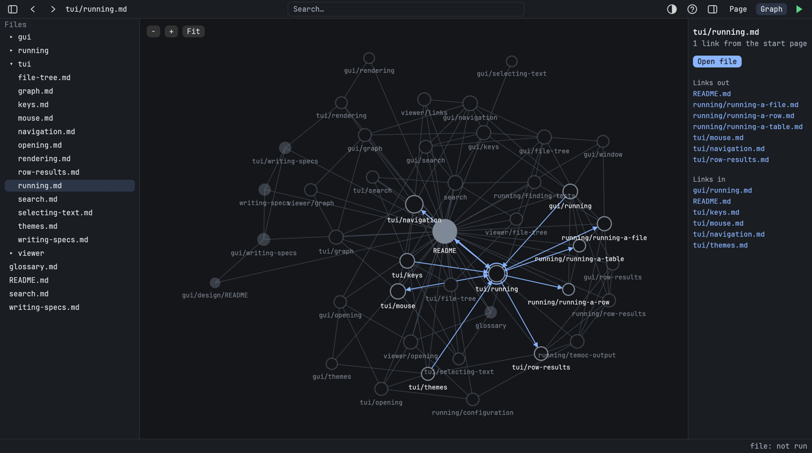

# Graph View

Back to the [specification index](../README.md).

`Ctrl-g` or the `Graph` button shows the workspace's [graph](../viewer/graph.md) in place
of the page. `Esc`, `Ctrl-g` or the `Page` button returns to the document.

[//]: # "import Spec.Fixtures"
[//]: # "decisionTable Gui"

| # situation      | workspace | actions                      | graph open? |
| ---------------- | --------- | ---------------------------- | ----------- |
| Closed at first  | docs      |                              | no          |
| The key          | docs      | `Ctrl-g`                     | yes         |
| The button       | docs      | `Click "Graph"`              | yes         |
| Esc              | docs      | `Ctrl-g Esc`                 | no          |
| The key again    | docs      | `Ctrl-g Ctrl-g`              | no          |
| The other button | docs      | `Click "Graph" Click "Page"` | no          |

## Layout

Unlike the [terminal's columns](../tui/graph.md#columns), the files find their own places.
Files that link to each other pull together, every file pushes the others away, and a
file with no links floats free. A file with more links is drawn larger.

The files move until they settle, and the layout starts from the same places every
time, so that a workspace looks the same each time you open it.

[//]: # "decisionTable Gui"

| # situation | workspace  | actions  | settled? | same layout? |
| ----------- | ---------- | -------- | -------- | ------------ |
| It settles  | docs       | `Ctrl-g` | yes      | yes          |
| A chain     | link-chain | `Ctrl-g` | yes      | yes          |
| Many pages  | many-pages | `Ctrl-g` | yes      | yes          |

## Moving around

Dragging a file moves it, and only it. It stays there until the graph closes. Dragging
the background moves the whole view, the wheel zooms, and `Fit` puts everything back.

[//]: # "decisionTable Gui"

| # situation      | workspace | actions                                       | node moved? | others moved? |
| ---------------- | --------- | --------------------------------------------- | ----------- | ------------- |
| Drag a file      | docs      | `Ctrl-g Drag node "reference.md"`             | yes         | no            |
| Fit puts it back | docs      | `Ctrl-g Drag node "reference.md" Click "Fit"` | no          | no            |

## Selecting a file

The open document starts selected. Clicking a file selects it, and clicking it again
opens it, as does `Enter` or `Open file`. Going [back](navigation.md#history) returns to
the previous document.

The arrow keys select the nearest file in that direction, and `Home` selects the start
page.

[//]: # "decisionTable Gui"

| # situation       | workspace | arguments    | actions                                              | graph open? | selected file? | document?    |
| ----------------- | --------- | ------------ | ---------------------------------------------------- | ----------- | -------------- | ------------ |
| The open document | docs      |              | `Ctrl-g`                                             | yes         | README.md      | README.md    |
| It follows        | docs      | reference.md | `Ctrl-g`                                             | yes         | reference.md   | reference.md |
| A click selects   | docs      |              | `Ctrl-g Click node "notes.MD"`                       | yes         | notes.MD       | README.md    |
| A second opens    | docs      |              | `Ctrl-g Click node "notes.MD" Click node "notes.MD"` | no          | none           | notes.MD     |
| Enter opens       | docs      |              | `Ctrl-g Click node "notes.MD" Enter`                 | no          | none           | notes.MD     |
| The button opens  | docs      |              | `Ctrl-g Click node "notes.MD" Click "Open file"`     | no          | none           | notes.MD     |
| Go back           | docs      |              | `Ctrl-g Click node "notes.MD" Enter Alt-Left`        | no          | none           | README.md    |
| Home goes there   | docs      | reference.md | `Ctrl-g Home`                                        | yes         | README.md      | reference.md |
| Leaving           | docs      |              | `Ctrl-g Click node "notes.MD" Esc`                   | no          | none           | README.md    |

## Seeing the links

A panel beside the graph lists the selected file's links, including
[broken ones](../viewer/graph.md#links), and its [distance](../viewer/graph.md#distance).
Clicking a link selects that file.

[//]: # "decisionTable Gui"

| # situation     | workspace | actions                                                             | selected file?           | distance?                         | links out?                                                                       | links in?                           |
| --------------- | --------- | ------------------------------------------------------------------- | ------------------------ | --------------------------------- | -------------------------------------------------------------------------------- | ----------------------------------- |
| The start page  | docs      | `Ctrl-g`                                                            | README.md                | The start page                    | guide/getting-started.md, guide/long-page.md, missing.md (missing), reference.md | guide/getting-started.md            |
| One link away   | docs      | `Ctrl-g Click node "reference.md"`                                  | reference.md             | 1 link from the start page        | guide/getting-started.md                                                         | guide/getting-started.md, README.md |
| Not reachable   | docs      | `Ctrl-g Click node "notes.MD"`                                      | notes.MD                 | Not reachable from the start page | none                                                                             | none                                |
| Clicking a link | docs      | `Ctrl-g Click node "reference.md" Click "guide/getting-started.md"` | guide/getting-started.md | 1 link from the start page        | README.md, reference.md                                                          | README.md, reference.md             |

The graph draws attention to one file and the files it links with, and fades the rest.
That file is the one under the pointer, or else the selected file. Only its links show
arrowheads, which point at the target. A pair of files that link both ways shares one
line with an arrowhead at each end.

[//]: # "decisionTable Gui"

| # situation     | workspace | actions                                  | lit files?                                        | arrowheads? |
| --------------- | --------- | ---------------------------------------- | ------------------------------------------------- | ----------- |
| The selection   | docs      | `Ctrl-g Click node "reference.md"`       | guide/getting-started.md, README.md, reference.md | 3           |
| The pointer     | docs      | `Ctrl-g Hover node "guide/long-page.md"` | guide/long-page.md, README.md                     | 1           |
| No links at all | docs      | `Ctrl-g Click node "notes.MD"`           | notes.MD                                          | 0           |

## Results in the graph

A file that has a result shows it. See how it looks
[after a run](design/images/graph-results.png).

[//]: # "decisionTable Gui"

| # situation  | workspace  | arguments  | actions         | file       | node result? |
| ------------ | ---------- | ---------- | --------------- | ---------- | ------------ |
| Before a run | calculator | failing.md | `Ctrl-g`        | failing.md | none         |
| After a run  | calculator | failing.md | `Ctrl-r Ctrl-g` | failing.md | failed       |
| Another file | calculator | failing.md | `Ctrl-r Ctrl-g` | passing.md | none         |
