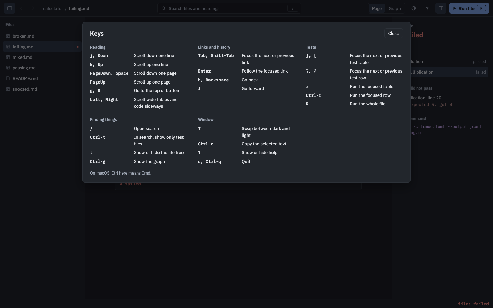

# Keys

Back to the [specification index](../README.md).

The keys are the ones a window usually has, not the [terminal's](../tui/keys.md). None of
them is a bare letter, and `Ctrl` is `Cmd` on macOS. What has a button of its own and is
seldom needed, such as swapping between dark and light, has no key.

| Key                          | Action                               | Described in                        |
| ---------------------------- | ------------------------------------ | ----------------------------------- |
| `Up`, `Down`                 | Scroll up or down one line           | [Navigation](navigation.md)         |
| `PageDown`, `Space`          | Scroll down one page                 | [Navigation](navigation.md)         |
| `PageUp`                     | Scroll up one page                   | [Navigation](navigation.md)         |
| `Home`, `End`                | Go to the top or bottom              | [Navigation](navigation.md)         |
| `Left`, `Right`              | Scroll a wide table or code sideways | [Navigation](navigation.md)         |
| `Tab`, `Shift-Tab`           | Focus the next or previous link      | [Navigation](navigation.md)         |
| `Enter`                      | Follow the focused link              | [Navigation](navigation.md)         |
| `Alt-Left`, `Ctrl-[`         | Go back                              | [Navigation](navigation.md)         |
| `Alt-Right`, `Ctrl-]`        | Go forward                           | [Navigation](navigation.md)         |
| `Ctrl-k`, `/`                | Open search                          | [Search](search.md)                 |
| `Alt-Down`, `Alt-Up`         | Focus the next or previous test table | [Running tests](running.md)        |
| `Alt-Shift-Down`, `Alt-Shift-Up` | Focus the next or previous test row | [Running tests](running.md)      |
| `Ctrl-Enter`                 | Run the focused row, or else the focused table | [Running tests](running.md) |
| `Ctrl-r`                     | Run the whole file                   | [Running tests](running.md)         |
| `Ctrl-b`                     | Show or hide the file tree           | [File tree](file-tree.md)           |
| `Ctrl-g`                     | Show or hide the graph               | [Graph view](graph.md)              |
| `Ctrl-c`                     | Copy the selected text               | [Selecting text](selecting-text.md) |
| `F1`, `?`                    | Show or hide help                    | This page                           |
| `Ctrl-q`                     | Quit                                 | This page                           |

The [graph](graph.md#selecting-a-file) reuses some of these keys while it shows.

## Help and quitting

`F1`, `?` or the toolbar button shows help, which lists these keys, and any of those keys
or `Esc` hides it. The search box [keeps typing to itself](search.md#typing-stays-typing),
so `?` is typed there, and `Ctrl-q` still quits.

[//]: # "import Spec.Fixtures"
[//]: # "decisionTable Gui"

| # situation     | workspace | actions             | help open? |
| --------------- | --------- | ------------------- | ---------- |
| Hidden at first | docs      |                     | no         |
| The key         | docs      | `F1`                | yes        |
| The other key   | docs      | `?`                 | yes        |
| The button      | docs      | `Click "Show help"` | yes        |
| Hides again     | docs      | `F1 F1`             | no         |
| Esc hides it    | docs      | `F1 Esc`            | no         |

[//]: # "decisionTable Gui -- snooze until 2099-12-31"

| # situation    | workspace | actions     | help open? |
| -------------- | --------- | ----------- | ---------- |
| Over the graph | docs      | `Ctrl-g F1` | yes        |

[//]: # "decisionTable Gui"

| # situation        | workspace | actions        | still open? |
| ------------------ | --------- | -------------- | ----------- |
| Running            | docs      |                | yes         |
| Ctrl-q quits       | docs      | `Ctrl-q`       | no          |
| Ctrl-c does not    | docs      | `Ctrl-c`       | yes         |
| Ctrl-q in search   | docs      | `/ Ctrl-q`     | no          |
| Closing the window | docs      | `Close window` | no          |
