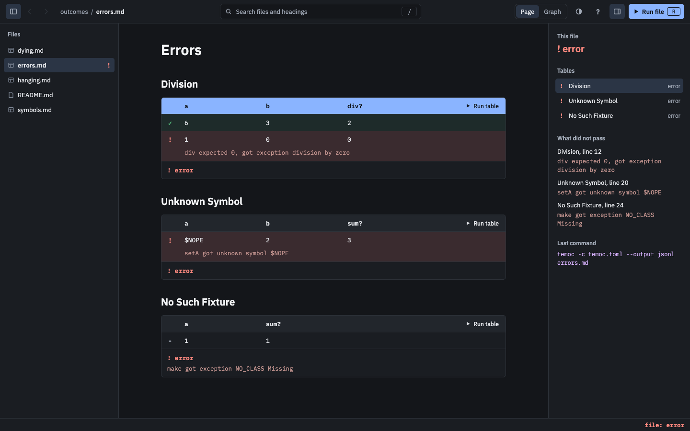

# Row Results

Back to the [specification index](../README.md).

Every row that runs shows its [result](../running/row-results.md) as soon as temoc
finishes that row, while the rest of the file is still running.

## Marks

A row with a result gets the same mark as in the [terminal](../tui/row-results.md#marks-and-colours),
so that a result never depends on colour alone. A row with no result yet has no mark.

[//]: # "import Spec.Fixtures"
[//]: # "decisionTable Gui -- snooze until 2099-12-31"

| # situation  | workspace  | arguments  | actions | marks?                    |
| ------------ | ---------- | ---------- | ------- | ------------------------- |
| Before a run | calculator | failing.md |         | none                      |
| Passed       | calculator | passing.md | `R`     | 11: ✓, 19: ✓, 20: ✓       |
| Failed       | calculator | failing.md | `R`     | 11: ✓, 19: ✓, 20: ✗       |
| Snoozed      | calculator | snoozed.md | `R`     | 11: ✓, 19: ✓, 20: ~       |
| An error     | outcomes   | errors.md  | `R`     | 11: ✓, 12: !, 20: !, 28: - |
| Skipped      | outcomes   | dying.md   | `R`     | 11: ✓, 12: !, 13: -, 21: - |
| Running      | outcomes   | hanging.md | `R Wait row 13` | 11: ✓, 12: ✗, 13: ⋯ |

Marks stay in view when a wide table scrolls sideways.

[//]: # "decisionTable Gui -- snooze until 2099-12-31"

| # situation        | workspace | arguments    | actions                          | look for       | mark shown? | sideways? |
| ------------------ | --------- | ------------ | -------------------------------- | -------------- | ----------- | --------- |
| Scrolled sideways  | elements  | wide-test.md | `R Shift-Wheel "a long comment"` | a long comment | yes         | middle    |

## Notes

A row that did not pass has a note below it, with one line for each check that did not
pass. Only the first line of a message shows. See
[how messages are worded](../running/temoc-output.md#messages).

[//]: # "decisionTable Gui -- snooze until 2099-12-31"

| # situation       | workspace  | arguments  | actions | row | note?                                            |
| ----------------- | ---------- | ---------- | ------- | --- | ------------------------------------------------ |
| Not run           | calculator | failing.md |         | 20  | none                                             |
| A passing row     | calculator | failing.md | `R`     | 19  | none                                             |
| A wrong value     | calculator | failing.md | `R`     | 20  | mul expected 5, got 4                            |
| An exception      | outcomes   | errors.md  | `R`     | 12  | div expected 0, got exception division by zero   |
| An unknown symbol | outcomes   | errors.md  | `R`     | 20  | setA got unknown symbol $NOPE                    |
| A snoozed row     | calculator | snoozed.md | `R`     | 20  | mul expected 5, got 4 (snoozed until 2099-12-31) |

## Table results

Each table that has a result says so below itself, followed by any
[failures that belong to the table](../running/row-results.md#failures-outside-a-row)
and not to a row.

[//]: # "decisionTable Gui -- snooze until 2099-12-31"

| # situation       | workspace  | arguments  | actions         | table verdicts?                  |
| ----------------- | ---------- | ---------- | --------------- | -------------------------------- |
| Before a run      | calculator | failing.md |                 | none                             |
| A file            | calculator | failing.md | `R`             | ✓ passed, ✗ failed               |
| One table         | calculator | failing.md | `r`             | ✓ passed                         |
| A row at a time   | calculator | failing.md | `] } Ctrl-r`    | · partial                        |
| In the middle     | outcomes   | hanging.md | `R Wait row 13` | ⋯ running                        |

[//]: # "decisionTable Gui -- snooze until 2099-12-31"

| # situation     | workspace | arguments | actions | look for                            | visible? |
| --------------- | --------- | --------- | ------- | ----------------------------------- | -------- |
| A missing class | outcomes  | errors.md | `R G`   | make got exception NO_CLASS Missing | yes      |

## Keeping results

Results stay on the page while you read something else, and a new run clears
[only what it is about to run](../running/row-results.md#starting-again).

[//]: # "decisionTable Gui -- snooze until 2099-12-31"

| # situation    | workspace  | arguments  | actions                                     | document?  | file result? |
| -------------- | ---------- | ---------- | ------------------------------------------- | ---------- | ------------ |
| Going away     | calculator | passing.md | `R Click tree "failing.md" h`               | passing.md | passed       |
