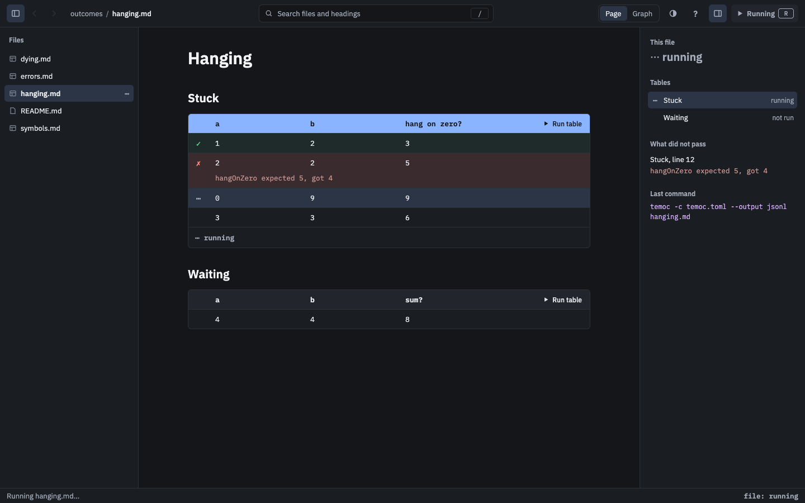
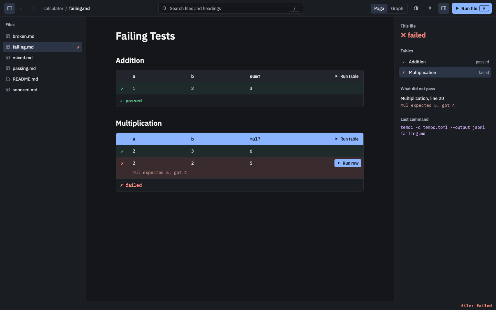
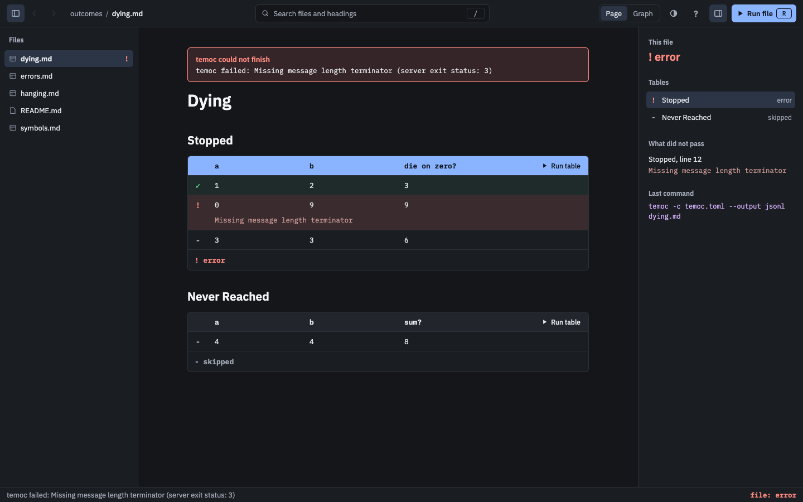

# Running Tests

Back to the [specification index](../README.md).

There are buttons for everything, and the [terminal's keys](../tui/running.md) work too:
`R` [runs the open file](../running/running-a-file.md), `r`
[the focused table](../running/running-a-table.md) and `Ctrl-r`
[the focused row](../running/running-a-row.md).

## Running a file

`Run file` is in the toolbar, on test pages only.

[//]: # "import Spec.Fixtures"
[//]: # "decisionTable Gui -- snooze until 2099-12-31"

| # situation    | workspace  | arguments  | actions           | run file? | temoc arguments?                        |
| -------------- | ---------- | ---------- | ----------------- | --------- | --------------------------------------- |
| Before a run   | calculator | passing.md |                   | enabled   | none                                    |
| The button     | calculator | passing.md | `Click "Run file"` | enabled  | -c temoc.toml --output jsonl passing.md |
| The key        | calculator | passing.md | `R`               | enabled   | -c temoc.toml --output jsonl passing.md |
| No tests here  | calculator | README.md  |                   | none      | none                                    |

## Choosing a table

The first table is focused when a test file opens. `]` and `[` move between tables, and
clicking a table's header focuses it. Focus stops at the first and last tables.

[//]: # "decisionTable Gui -- snooze until 2099-12-31"

| # situation      | workspace  | arguments  | actions                     | focused table? |
| ---------------- | ---------- | ---------- | --------------------------- | -------------- |
| The first table  | calculator | passing.md |                             | Addition       |
| Next table       | calculator | passing.md | `]`                         | Multiplication |
| Previous table   | calculator | passing.md | `] [`                       | Addition       |
| Stops at the end | calculator | passing.md | `] ]`                       | Multiplication |
| A click          | calculator | passing.md | `Click "mul?"`              | Multiplication |

## Running a table

Every test table has a `Run table` button, which runs that table and focuses it.

[//]: # "decisionTable Gui -- snooze until 2099-12-31"

| # situation  | workspace  | arguments  | actions                                | focused table? | temoc arguments?                           |
| ------------ | ---------- | ---------- | -------------------------------------- | -------------- | ------------------------------------------ |
| The button   | calculator | passing.md | `Click "Run table" in "Multiplication"` | Multiplication | -c temoc.toml --output jsonl passing.md:15 |
| The key      | calculator | passing.md | `r`                                    | Addition       | -c temoc.toml --output jsonl passing.md:7  |
| After moving | calculator | passing.md | `] r`                                  | Multiplication | -c temoc.toml --output jsonl passing.md:15 |

## Choosing a row

`}` and `{` move between the rows of the focused table, as in the
[terminal](../tui/running.md#choosing-a-row). Clicking a row focuses it, and its table.

[//]: # "decisionTable Gui -- snooze until 2099-12-31"

| # situation       | workspace  | arguments  | actions        | focused row? | focused table? |
| ----------------- | ---------- | ---------- | -------------- | ------------ | -------------- |
| None at first     | calculator | passing.md |                | none         | Addition       |
| The first row     | calculator | passing.md | `}`            | 11           | Addition       |
| The next row      | calculator | passing.md | `] } }`        | 20           | Multiplication |
| A click           | calculator | passing.md | `Click row 20` | 20           | Multiplication |
| Moving to a table | calculator | passing.md | `} ]`          | none         | Multiplication |

## Running a row

Moving the pointer over a test row shows a `Run row` button on that row, so that one
click runs it, with no need to focus it first. The button goes when the pointer leaves.
The focused row always shows the button. Rows of other tables have none.

[//]: # "decisionTable Gui -- snooze until 2099-12-31"

| # situation        | workspace  | arguments    | actions                 | run row?    | focused row? |
| ------------------ | ---------- | ------------ | ----------------------- | ----------- | ------------ |
| Nothing at first   | calculator | passing.md   |                         | none        | none         |
| Hovering           | calculator | passing.md   | `Hover row 20`          | 20: enabled | none         |
| Another row        | calculator | passing.md   | `Hover row 20 Hover row 19` | 19: enabled | none     |
| Leaving            | calculator | passing.md   | `Hover row 20 Leave`    | none        | none         |
| The focused row    | calculator | passing.md   | `Click row 20 Leave`    | 20: enabled | 20           |
| Focus and hover    | calculator | passing.md   | `Click row 20 Hover row 19` | 19: enabled, 20: enabled | 20 |
| Not a test table   | docs       | reference.md | `Hover "Opens a file"`  | none        | none         |

[//]: # "decisionTable Gui -- snooze until 2099-12-31"

| # situation     | workspace  | arguments  | actions                            | row results? | focused row? | temoc arguments?                           |
| --------------- | ---------- | ---------- | ---------------------------------- | ------------ | ------------ | ------------------------------------------ |
| One click       | calculator | failing.md | `Hover row 20 Click "Run row"`     | 20: failed   | none         | -c temoc.toml --output jsonl failing.md:20 |
| The key         | calculator | failing.md | `Click row 20 Ctrl-r`              | 20: failed   | 20           | -c temoc.toml --output jsonl failing.md:20 |

## While a run goes on

The buttons that run something are disabled, and the keys are
[refused](../running/row-results.md#while-a-run-goes-on). The page stays usable, and the
status bar says what is running.

[//]: # "decisionTable Gui -- snooze until 2099-12-31"

| # situation      | workspace | arguments  | actions                        | run file? | run row?     | status?                  |
| ---------------- | --------- | ---------- | ------------------------------ | --------- | ------------ | ------------------------ |
| In the middle    | outcomes  | hanging.md | `R Wait row 13`                | disabled  | none         | Running hanging.md...    |
| Hovering a row   | outcomes  | hanging.md | `R Wait row 13 Hover row 14`   | disabled  | 14: disabled | Running hanging.md...    |
| The key          | outcomes  | hanging.md | `R Wait row 13 r`              | disabled  | none         | temoc is already running |

Closing the window [stops the run](../running/row-results.md#while-a-run-goes-on).

[//]: # "decisionTable Gui -- snooze until 2099-12-31"

| # situation    | workspace | arguments  | actions                      | still open? |
| -------------- | --------- | ---------- | ---------------------------- | ----------- |
| Closing        | outcomes  | hanging.md | `R Wait row 13 Close window` | no          |

## The tests panel

On a test page, a panel beside the page sums up the file: its result, its tables, what
did not pass, and the last temoc command. Clicking a table or a failure focuses it.

[//]: # "decisionTable Gui -- snooze until 2099-12-31"

| # situation   | workspace  | arguments  | actions | tests panel?                               | not passed?                                  | last command?                                 |
| ------------- | ---------- | ---------- | ------- | ------------------------------------------ | -------------------------------------------- | --------------------------------------------- |
| Before a run  | calculator | failing.md |         | Addition: not run, Multiplication: not run | none                                         | none                                          |
| After a run   | calculator | failing.md | `R`     | Addition: passed, Multiplication: failed   | Multiplication line 20: mul expected 5, got 4 | temoc -c temoc.toml --output jsonl failing.md |

[//]: # "decisionTable Gui -- snooze until 2099-12-31"

| # situation     | workspace  | arguments  | actions                                | focused table? | focused row? |
| --------------- | ---------- | ---------- | -------------------------------------- | -------------- | ------------ |
| A table         | calculator | failing.md | `Click "Multiplication"`               | Multiplication | none         |
| A failure       | calculator | failing.md | `R Click "mul expected 5, got 4"`      | Multiplication | 20           |

## When it cannot run

A test page that cannot run says so in a banner above the page, before you try. Trying
says so in the status bar too, as does [what temoc reports](../running/running-a-file.md#when-temoc-cannot-finish)
when it cannot finish, because one line at the bottom of a large window is easy to miss.
The page stays readable either way.

[//]: # "decisionTable Gui -- snooze until 2099-12-31"

| # situation         | workspace    | arguments | actions | banner?                                                                 | status?                                                                 |
| ------------------- | ------------ | --------- | ------- | ----------------------------------------------------------------------- | ----------------------------------------------------------------------- |
| No configuration    | unconfigured | tests.md  |         | No temoc configuration found. Add temoc.toml or use --config.           | none                                                                    |
| Trying anyway       | unconfigured | tests.md  | `R`     | No temoc configuration found. Add temoc.toml or use --config.           | No temoc configuration found. Add temoc.toml or use --config.           |
| Server stops midway | outcomes     | dying.md  | `R`     | temoc failed: Missing message length terminator (server exit status: 3) | temoc failed: Missing message length terminator (server exit status: 3) |
| All is well         | calculator   | failing.md | `R`    | none                                                                    | none                                                                    |
