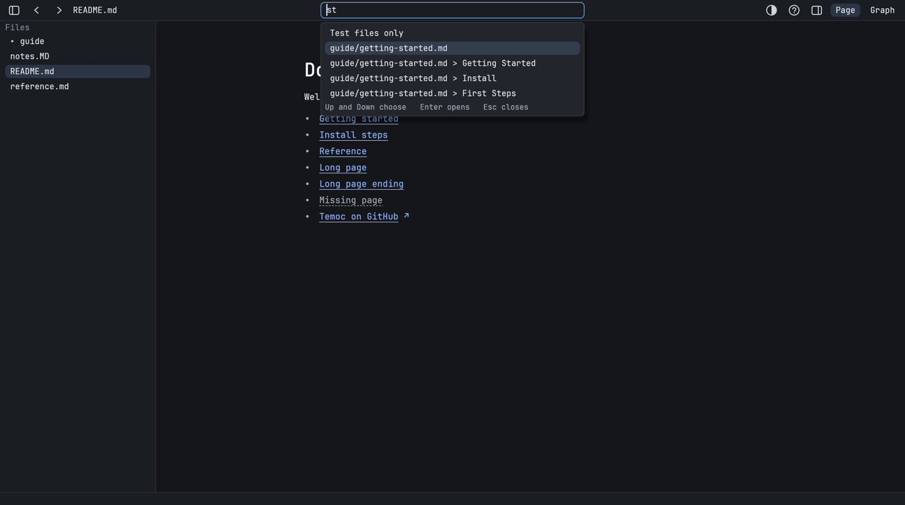

# Search

Back to the [specification index](../README.md).

`Ctrl-k`, `/` or clicking the search field in the toolbar starts a search. Typing in the
field narrows [what can be found](../search.md), and the results open under it, over the
page. `Up` and `Down` choose a result, `Enter` opens it, and `Esc` or a click anywhere else
closes search without moving. That click does nothing else, so a link it lands on is not
followed.

[//]: # "import Spec.Fixtures"
[//]: # "decisionTable Gui"

| # situation     | workspace | actions                             | search open? | results?                                                                        |
| --------------- | --------- | ----------------------------------- | ------------ | ------------------------------------------------------------------------------- |
| Closed at first | docs      |                                     | no           | none                                                                            |
| The key         | docs      | `Ctrl-k`                            | yes          | guide/getting-started.md, guide/long-page.md, notes.MD, README.md, reference.md |
| The slash       | docs      | `/`                                 | yes          | guide/getting-started.md, guide/long-page.md, notes.MD, README.md, reference.md |
| The toolbar     | docs      | `Click "Search files and headings"` | yes          | guide/getting-started.md, guide/long-page.md, notes.MD, README.md, reference.md |
| Typing narrows  | docs      | `/ "install"`                       | yes          | guide/getting-started.md > Install                                              |
| Esc closes      | docs      | `/ Esc`                             | no           | none                                                                            |

## Opening a result

Clicking a result opens it too. Going [back](navigation.md#history) returns to where
you were.

[//]: # "decisionTable Gui"

| # situation           | workspace | actions                        | document?          | search open? |
| --------------------- | --------- | ------------------------------ | ------------------ | ------------ |
| The top result        | docs      | `/ "reference" Enter`          | reference.md       | no           |
| Choose a result       | docs      | `/ Down Enter`                 | guide/long-page.md | no           |
| Click a result        | docs      | `/ Click "guide/long-page.md"` | guide/long-page.md | no           |
| Enter with no results | docs      | `/ "zzz" Enter`                | README.md          | yes          |
| A click elsewhere     | docs      | `/ Click "Reference"`          | README.md          | no           |
| A click on the filter | docs      | `/ Click "Test files only"`    | README.md          | yes          |
| Back to the start     | docs      | `/ "reference" Enter Alt-Left` | README.md          | no           |

## Typing stays typing

While the search field has the keyboard, `/` and `?` are typed like any other character.

[//]: # "decisionTable Gui"

| # situation | workspace | actions | search open? | still open? | mode? | help open? |
| ----------- | --------- | ------- | ------------ | ----------- | ----- | ---------- |
| ? is typed  | docs      | `/ ?`   | yes          | yes         | dark  | no         |
| / is typed  | docs      | `/ /`   | yes          | yes         | dark  | no         |

## Showing only test files

The `Test files only` button shows only
[test files](../search.md#showing-only-test-files), and doing it again shows everything.
The choice is remembered until temoc-ui closes.

[//]: # "decisionTable Gui"

| # situation          | workspace  | actions                                             | results?                                                           |
| -------------------- | ---------- | --------------------------------------------------- | ------------------------------------------------------------------ |
| The button           | calculator | `/ Click "Test files only"`                         | broken.md, failing.md, mixed.md, passing.md, snoozed.md            |
| Back to all files    | calculator | `/ Click "Test files only" Click "Test files only"` | broken.md, failing.md, mixed.md, passing.md, README.md, snoozed.md |
| Remembered next time | calculator | `/ Click "Test files only" Esc /`                   | broken.md, failing.md, mixed.md, passing.md, snoozed.md            |
