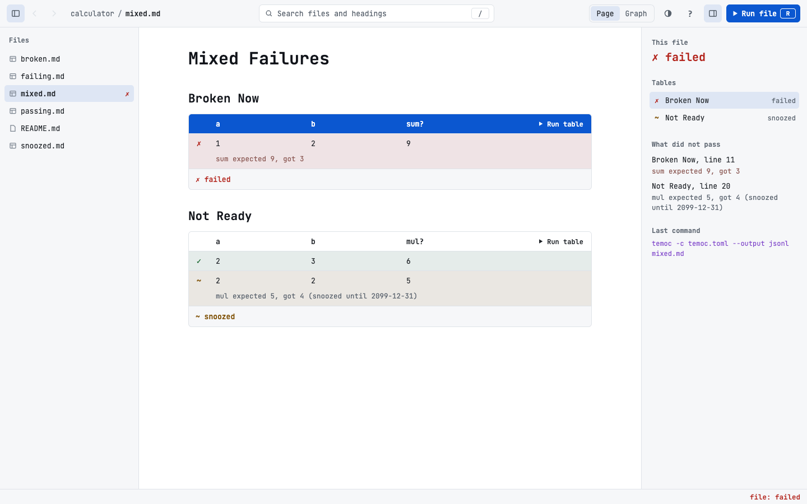

# Dark and Light

Back to the [specification index](../README.md).

The GUI has a dark mode and a light mode, with colours of its own. The
[terminal's themes](../tui/themes.md) do not apply to it, and neither does `--theme`.
The colours are in the [design](design/images/tokens.png).

## Which mode opens

The GUI follows the system. If the system does not say, it opens dark.

[//]: # "import Spec.Fixtures"
[//]: # "decisionTable Gui"

| # situation         | workspace | system mode | mode? |
| ------------------- | --------- | ----------- | ----- |
| Nothing is known    | docs      |             | dark  |
| A dark system       | docs      | dark        | dark  |
| A light system      | docs      | light       | light |

## Swapping

The toolbar button swaps between dark and light. The choice lasts until temoc-ui
closes, and nothing else on screen changes.

[//]: # "decisionTable Gui"

| # situation | workspace | system mode | actions                                                                   | mode? | document?    |
| ----------- | --------- | ----------- | ------------------------------------------------------------------------- | ----- | ------------ |
| The button  | docs      | dark        | `Click "Swap between dark and light"`                                     | light | README.md    |
| And back    | docs      | dark        | `Click "Swap between dark and light" Click "Swap between dark and light"` | dark  | README.md    |
| From light  | docs      | light       | `Click "Swap between dark and light"`                                     | dark  | README.md    |
| Moving on   | docs      | dark        | `Click "Swap between dark and light" Click "Reference"`                   | light | reference.md |
