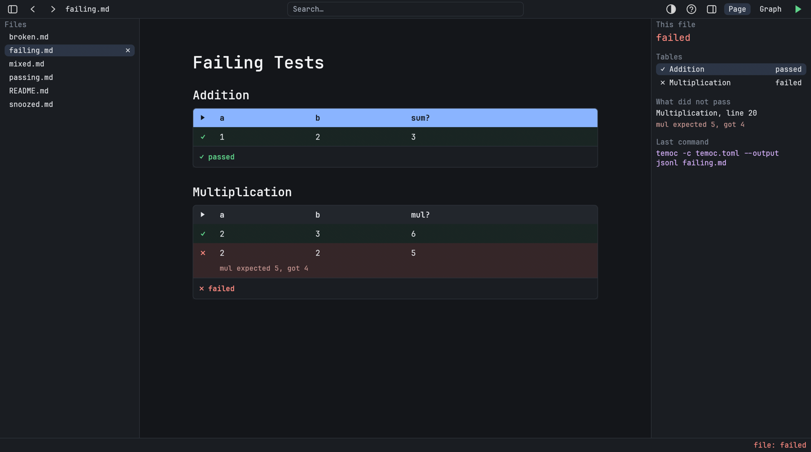

# The Window

Back to the [specification index](../README.md).

The window has a toolbar at the top, a status bar at the bottom, and the page in the
middle. The [file tree](file-tree.md) sits on the left. On a test page, the
[tests panel](running.md#the-tests-panel) sits on the right.

## The panels

Both panels start open, and each has a button in the toolbar. They stay how you left
them as you move between pages, until temoc-ui closes. A page without tests has no tests
panel, whatever the button says.

[//]: # "import Spec.Fixtures"
[//]: # "decisionTable Gui"

| # situation            | workspace  | arguments  | actions                                                                     | tree open? | tests panel open? |
| ---------------------- | ---------- | ---------- | --------------------------------------------------------------------------- | ---------- | ----------------- |
| A test page            | calculator | passing.md |                                                                             | yes        | yes               |
| A page without tests   | calculator | README.md  |                                                                             | yes        | no                |
| Hiding the tree        | calculator | passing.md | `Click "Show or hide the file tree"`                                        | no         | yes               |
| Hiding the tests panel | calculator | passing.md | `Click "Show or hide the tests panel"`                                      | yes        | no                |
| Showing it again       | calculator | passing.md | `Click "Show or hide the tests panel" Click "Show or hide the tests panel"` | yes        | yes               |
| It stays hidden        | calculator | passing.md | `Click "Show or hide the tests panel" Click tree "failing.md"`              | yes        | no                |

## The status bar

The status bar says what just happened on the left. On a test page that has results,
the [file result](../running/running-a-file.md#results) is on the right.

[//]: # "decisionTable Gui"

| # situation      | workspace  | arguments  | actions  | status? | file result? |
| ---------------- | ---------- | ---------- | -------- | ------- | ------------ |
| Nothing yet      | calculator | passing.md |          | none    | not run      |
| After a run      | calculator | failing.md | `Ctrl-r` | none    | failed       |
| A page, no tests | calculator | README.md  |          | none    | none         |
